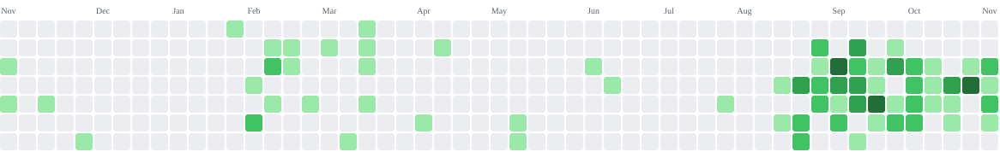
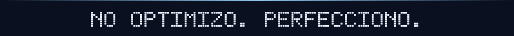

  

  

   

  
  
  
  
  
  
  

  
  

  <strong>Simbionte</strong> en la noche · <strong>Ultra Instinto</strong> cuando el ki sale azul

## Sobre mí

**Developer full stack** de Popayán. Me gusta el código que no se queda en el tutorial: productos que alguien abre, usa y confía.

Hoy estoy en **Senasoft Desarrollo Integral 2025**, construyendo software institucional con React, Node.js, TypeScript y PostgreSQL.

- **Cátedra de Familia** en producción en servidores de la **Alcaldía de Popayán** ([escuelapadres.popayan.gov.co](https://escuelapadres.popayan.gov.co)): escuela-familia para prevenir deserción y reclutamiento armado en el Occidente de la ciudad
- **Senasoft 2025** desarrollo integral, equipo y entrega bajo presión
- **SIGEVA** votación electrónica con roles, urna y resultados
- **MentorIA** plataforma educativa con IA (React, Node, Supabase, AWS)

> *La tecnología es mejor cuando une a las personas.*
> Si el dato importa, la seguridad no es un extra.

---

## En producción

### Cátedra de Familia

  
  
  

Plataforma institucional **desplegada en servidores de la Alcaldía de Popayán**. No es un demo: familias, docentes y administración ya entran por dominio `.gov.co`.

Nació como piloto **SENA Fábrica de Software 2026** con el colectivo pedagógico **Parchando Juntos**. El objetivo es concreto: fortalecer el vínculo escuela-familia en el **Occidente de Popayán**, bajar deserción y **prevenir el reclutamiento armado** de niños, niñas y jóvenes con formación, tareas en casa y evidencia en el boletín escolar.

Aliados: **Secretaría de Educación**, **Secretaría de Salud** y **SENA**.

- Roles en una sola plataforma (familias, docentes, administradores)
- Tareas semanales o quincenales para desarrollar en familia
- Evidencia (fotos, textos, archivos) y calificación en el boletín
- Confianza digital: uso institucional, claro y acompañado

**[Abrir la plataforma](https://escuelapadres.popayan.gov.co)** · [Front](https://github.com/ALexjh117/CATEDRA_FAMILIAR_FROTEND_117) · [Back](https://github.com/ALexjh117/ESCUELAPARAPADRES_BACKEND117)

---

<table>
  <tr>
    <td width="50%" valign="top">

### SIGEVA
**Sistema de Gestión de Votaciones Electrónicas**

Elecciones institucionales con autenticación, roles, voto único y consolidación de resultados. Pensado para centros de formación: transparente, auditable y usable el día de la jornada.

`React` `Node.js` `TypeScript` `PostgreSQL` `JWT`

- Control de roles (gestión / votante)
- Urna filtrada y emisión de voto único
- Panel para crear y administrar elecciones
- Reportes de participación y resultados

**[Back](https://github.com/ALexjh117/SigevaBack2.0)** · Senasoft 2025

    </td>
    <td width="50%" valign="top">

### MentorIA
**Plataforma educativa con inteligencia artificial**

Ayuda a estudiantes y profesores a personalizar el aprendizaje: chat con asistente, actividades adaptadas y un dashboard para ver el progreso de verdad, no solo “completado”.

`React` `Node.js` `TypeScript` `Supabase` `AWS Bedrock`

- Chat con asistente de IA
- Actividades según estilo de aprendizaje
- Métricas de progreso en tiempo real
- Dashboard de administración

**[Repo](https://github.com/ALexjh117/MentorIA)** · **[Front](https://github.com/ALexjh117/MentorFrontend)** · **[Back](https://github.com/ALexjh117/MentorBackend)**

    </td>
  </tr>
</table>

**También:** [ActivSena](https://github.com/ALexjh117/ActivSenaFull) (gestión de actividades en entorno SENA)

  

---

## Cómo trabajo

| Calidad > cantidad | Prefiero un flujo bien cerrado a diez pantallas a medias. |
| Seguridad primero | Auth, roles y votos únicos no se improvisan el último día. |
| Iterar en equipo | El PR revisado gana al héroe solitario. |
| Impacto institucional | Software en la Alcaldía, en el aula y en la urna. |
| Aprender en movimiento | Senasoft, proyectos reales, stack moderno. |

---

## Stack

  

---

## Arcade

El año de commits convertido en juego. Pac-Man se come la gráfica. Galaga le dispara. Se regeneran solos cada noche.

### Pac-Man

<picture>
  <source media="(prefers-color-scheme: dark)" srcset="https://raw.githubusercontent.com/ALexjh117/ALexjh117/output/pacman-contribution-graph-dark.svg" />
  <source media="(prefers-color-scheme: light)" srcset="https://raw.githubusercontent.com/ALexjh117/ALexjh117/output/pacman-contribution-graph.svg" />
  
</picture>

### Galaga

<picture>
  <source media="(prefers-color-scheme: dark)" srcset="https://raw.githubusercontent.com/ALexjh117/ALexjh117/output/galaga-contribution-graph-dark.svg" />
  <source media="(prefers-color-scheme: light)" srcset="https://raw.githubusercontent.com/ALexjh117/ALexjh117/output/galaga-contribution-graph.svg" />
  
</picture>

<strong>Más juegos de la gráfica</strong> (Tetris y Snake)

 

**Tetris.** Las piezas caen alineadas con tus commits y limpian líneas.

<picture>
  <source media="(prefers-color-scheme: dark)" srcset="https://raw.githubusercontent.com/ALexjh117/ALexjh117/output/tetris-contribution-graph-dark.svg" />
  <source media="(prefers-color-scheme: light)" srcset="https://raw.githubusercontent.com/ALexjh117/ALexjh117/output/tetris-contribution-graph.svg" />
  
</picture>

**Snake.** La serpiente crece solo con los días más intensos.

<picture>
  <source media="(prefers-color-scheme: dark)" srcset="https://raw.githubusercontent.com/ALexjh117/ALexjh117/output/snake-contribution-graph-dark.svg" />
  <source media="(prefers-color-scheme: light)" srcset="https://raw.githubusercontent.com/ALexjh117/ALexjh117/output/snake-contribution-graph.svg" />
  
</picture>

Otros juegos que se pueden activar

 

El mismo Action puede generar más tableros. Solo hay que sumar el nombre en `games:` del workflow.

| Juego | Qué hace con tus commits |
| :--- | :--- |
| **Breakout** | Una bola rompe los ladrillos de la gráfica |
| **Bomberman** | Dos bombers vuelan celdas del calendario |
| **Puzzle Bobble** | Un cañón explota grupos del mismo color |
| **Minesweeper** | Un solver limpia minas sobre los días |

Hechos con [pacman-contribution-graph](https://github.com/abozanona/pacman-contribution-graph).

---

## GitHub

  
  

---

## Hablemos

¿Idea, equipo, reto o café virtual? **Escríbeme.**

  
  
  

